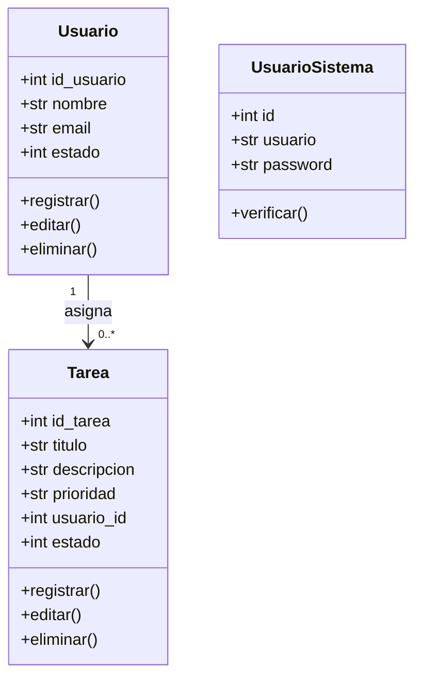
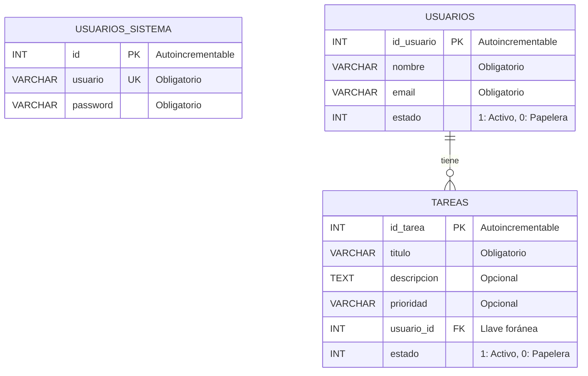

# Manual Técnico — Sistema de Gestión de Usuarios y Tareas (EC0835)

## Índice
1. Introducción  
2. Objetivo general del sistema  
3. Objetivos específicos del sistema  
4. Requerimientos de instalación  
5. Diagramas técnicos  
   - Diagrama de clases (UML)  
   - Diagrama Entidad–Relación (ER)  
6. Desarrollo técnico y arquitectura  
7. Código fuente de la aplicación  
8. Procedimiento de instalación y ejecución  
9. Generación del archivo ejecutable (`.exe`)  

---

## 1. Introducción
El sistema de **Gestión de Usuarios y Tareas** es una aplicación de escritorio desarrollada en **Python 3.10+** orientada a cumplir con los estándares de competencia laboral del estándar **EC0835 — Desarrollar software de aplicación con acceso a bases de datos**. 

La aplicación integra tecnologías clave para ofrecer una experiencia segura y robusta:
* **Tkinter:** Librería gráfica estándar de Python para el diseño de la interfaz de usuario mediante un sistema de pestañas (`ttk.Notebook`), formularios y paneles interactivos.
* **SQLite:** Motor de base de datos relacional local que garantiza el almacenamiento persistente y seguro de la información.

El sistema demuestra un dominio avanzado de operaciones CRUD completas, autenticación de usuarios, borrado lógico (papelera), manejo de llaves foráneas, validaciones de integridad referencial y generación de reportes gráficos con consultas `JOIN` y `GROUP BY`.

---

## 2. Objetivo general del sistema
Desarrollar, estructurar y documentar un sistema informático de escritorio autónomo, seguro y con control de acceso para la administración integral de usuarios y tareas, asegurando su correcta compilación en formato ejecutable (`.exe`) para entornos Windows.

---

## 3. Objetivos específicos del sistema
* **Control de Acceso y Seguridad:** Implementar un módulo de inicio de sesión y detección de primer arranque para la creación segura de cuentas administrativas.
* **Gestión de Usuarios y Tareas:** Proveer módulos completos para registrar, consultar, actualizar y realizar borrado lógico (envío a papelera) de registros.
* **Módulo de Papelera:** Permitir la recuperación de elementos desactivados (restauración) o su eliminación definitiva de la base de datos.
* **Módulo de Gráficas Estadísticas:** Visualizar reportes interactivos en tiempo real sobre tareas por usuario, por prioridad y comparativas de registros activos frente a la papelera.
* **Consultas SQL Avanzadas:** Ejecutar operaciones relacionales mediante `JOIN`, agrupaciones con `GROUP BY` y funciones de conteo (`COUNT`).
* **Generación de Ejecutable:** Compilar la solución en un archivo independiente (`.exe`) mediante **PyInstaller**.

---

## 4. Requerimientos de instalación

### Hardware mínimo
* **Procesador:** Intel i3 / Dual Core 2.0 GHz o superior.
* **Memoria RAM:** 4 GB mínimo.
* **Espacio en disco:** 200 MB libres.

### Software
* **Sistema Operativo:** Windows 10 o Windows 11.
* **Entorno de Ejecución:** Python 3.10 o superior (para modo código fuente).
* **Motor de Base de Datos:** SQLite 3 (integrado nativamente en Python).
* **Librerías y Dependencias (`requirements.txt`):**
  ```txt
  tkinter
  pyinstaller

---

## 5. Diagramas técnicos

## 5.1. Diagrama de clases (UML)



## 5.2. Diagrama Entidad–Relación (ER)




## 6. Desarrollo técnico y arquitectura

El proyecto sigue una arquitectura modular separada en componentes independientes para facilitar su mantenimiento, pruebas y escalabilidad:

```
proyecto_tareas/
│ ├── main.py       # Interfaz gráfica (Tkinter), autenticación y control de vistas
│ ├── crud.py       # Capa de lógica de datos, seguridad, papelera y consultas SQL
│ ├── models.py     # Clases orientadas a objetos (Usuario y Tarea)
│ ├── db.py         # Configuración SQLite, inicialización y migraciones de tablas
│ └── tareas.db     # Archivo de base de datos local persistente
│ └── requirements.txt     # Paquetes de dependencias
└── └── tareas.db     # Archivo de base de datos local SQLite
```

* **`db.py`:** Inicializa las tablas de sistema, usuarios y tareas, incorporando control de estados lógicos y migraciones automáticas.
* **`models.py`:** Define las clases de dominio estructurando los objetos del sistema.
* **`crud.py`:** Administra consultas parametrizadas para el CRUD, autenticación, gestión de papelera (soft-delete y borrado definitivo) y reportes estadísticos.
* **`main.py`:** Orquesta la interfaz gráfica basada en pestañas (Notebook), ventanas de acceso y renderizado dinámico de gráficos estadísticos en componentes Canvas.

---

## 7. Código fuente de la aplicación

### `db.py` (Conexión y Base de Datos)
```python
import sqlite3

DB_NAME = "tareas.db"

def get_connection():
    return sqlite3.connect(DB_NAME)

def init_db():
    con = get_connection()
    cur = con.cursor()

    # Tabla de Usuarios del Sistema (Login / Admin)
    cur.execute("""
    CREATE TABLE IF NOT EXISTS UsuariosSistema (
        id INTEGER PRIMARY KEY AUTOINCREMENT,
        usuario TEXT UNIQUE NOT NULL,
        password TEXT NOT NULL
    )
    """)

    # Tabla Usuarios con columna estado (1: Activo, 0: Papelera)
    cur.execute("""
    CREATE TABLE IF NOT EXISTS Usuarios (
        id_usuario INTEGER PRIMARY KEY AUTOINCREMENT,
        nombre TEXT NOT NULL,
        email TEXT NOT NULL,
        estado INTEGER DEFAULT 1
    )
    """)

    # Tabla Tareas con columna estado (1: Activo, 0: Papelera)
    cur.execute("""
    CREATE TABLE IF NOT EXISTS Tareas (
        id_tarea INTEGER PRIMARY KEY AUTOINCREMENT,
        titulo TEXT NOT NULL,
        descripcion TEXT,
        prioridad TEXT,
        usuario_id INTEGER,
        estado INTEGER DEFAULT 1,
        FOREIGN KEY(usuario_id) REFERENCES Usuarios(id_usuario)
    )
    """)

    # Migración segura por si la base de datos anterior no tenía la columna estado
    try:
        cur.execute("ALTER TABLE Usuarios ADD COLUMN estado INTEGER DEFAULT 1")
    except sqlite3.OperationalError:
        pass

    try:
        cur.execute("ALTER TABLE Tareas ADD COLUMN estado INTEGER DEFAULT 1")
    except sqlite3.OperationalError:
        pass

    con.commit()
    con.close()
```

### `models.py` (Clases del Sistema)
```python
class Usuario:
    def __init__(self, id_usuario, nombre, email):
        self.id_usuario = id_usuario
        self.nombre = nombre
        self.email = email

class Tarea:
    def __init__(self, id_tarea, titulo, descripcion, prioridad, usuario_id):
        self.id_tarea = id_tarea
        self.titulo = titulo
        self.descripcion = descripcion
        self.prioridad = prioridad
        self.usuario_id = usuario_id
```

### `crud.py` (Operaciones CRUD y Consultas)
```python
from db import get_connection

# ============ AUTENTICACIÓN / SISTEMA ============
def hay_usuarios_sistema():
    con = get_connection()
    cur = con.cursor()
    cur.execute("SELECT COUNT(*) FROM UsuariosSistema")
    count = cur.fetchone()[0]
    con.close()
    return count > 0

def registrar_admin(usuario, password):
    con = get_connection()
    cur = con.cursor()
    try:
        cur.execute("INSERT INTO UsuariosSistema (usuario, password) VALUES (?, ?)", (usuario, password))
        con.commit()
        exito = True
    except sqlite3.IntegrityError:
        exito = False
    con.close()
    return exito

def verificar_credenciales(usuario, password):
    con = get_connection()
    cur = con.cursor()
    cur.execute("SELECT * FROM UsuariosSistema WHERE usuario = ? AND password = ?", (usuario, password))
    res = cur.fetchone()
    con.close()
    return res is not None

# ============ USUARIOS ============
def registrar_usuario(nombre, email):
    con = get_connection()
    cur = con.cursor()
    cur.execute("INSERT INTO Usuarios (nombre, email, estado) VALUES (?, ?, 1)", (nombre, email))
    con.commit()
    con.close()

def editar_usuario(id_usuario, nombre, email):
    con = get_connection()
    cur = con.cursor()
    cur.execute("UPDATE Usuarios SET nombre=?, email=? WHERE id_usuario=?", (nombre, email, id_usuario))
    con.commit()
    con.close()

def eliminar_usuario(id_usuario):
    # Borrado lógico (Papelera)
    con = get_connection()
    cur = con.cursor()
    cur.execute("UPDATE Usuarios SET estado=0 WHERE id_usuario=?", (id_usuario,))
    con.commit()
    con.close()

def restaurar_usuario(id_usuario):
    con = get_connection()
    cur = con.cursor()
    cur.execute("UPDATE Usuarios SET estado=1 WHERE id_usuario=?", (id_usuario,))
    con.commit()
    con.close()

def eliminar_usuario_definitivo(id_usuario):
    con = get_connection()
    cur = con.cursor()
    cur.execute("DELETE FROM Usuarios WHERE id_usuario=?", (id_usuario,))
    con.commit()
    con.close()

def obtener_usuarios():
    con = get_connection()
    cur = con.cursor()
    cur.execute("SELECT id_usuario, nombre, email FROM Usuarios WHERE estado = 1")
    datos = cur.fetchall()
    con.close()
    return datos

def obtener_usuarios_desactivados():
    con = get_connection()
    cur = con.cursor()
    cur.execute("SELECT id_usuario, nombre, email FROM Usuarios WHERE estado = 0")
    datos = cur.fetchall()
    con.close()
    return datos

def existe_usuario(id_usuario):
    con = get_connection()
    cur = con.cursor()
    cur.execute("SELECT id_usuario FROM Usuarios WHERE id_usuario = ? AND estado = 1", (id_usuario,))
    res = cur.fetchone()
    con.close()
    return res is not None

# ============ TAREAS ============
def registrar_tarea(titulo, descripcion, prioridad, usuario_id):
    con = get_connection()
    cur = con.cursor()
    cur.execute("INSERT INTO Tareas (titulo, descripcion, prioridad, usuario_id, estado) VALUES (?, ?, ?, ?, 1)",
                (titulo, descripcion, prioridad, usuario_id))
    con.commit()
    con.close()

def editar_tarea(id_tarea, titulo, descripcion, prioridad, usuario_id):
    con = get_connection()
    cur = con.cursor()
    cur.execute("UPDATE Tareas SET titulo=?, descripcion=?, prioridad=?, usuario_id=? WHERE id_tarea=?",
                (titulo, descripcion, prioridad, usuario_id, id_tarea))
    con.commit()
    con.close()

def eliminar_tarea(id_tarea):
    # Borrado lógico (Papelera)
    con = get_connection()
    cur = con.cursor()
    cur.execute("UPDATE Tareas SET estado=0 WHERE id_tarea=?", (id_tarea,))
    con.commit()
    con.close()

def restaurar_tarea(id_tarea):
    con = get_connection()
    cur = con.cursor()
    cur.execute("UPDATE Tareas SET estado=1 WHERE id_tarea=?", (id_tarea,))
    con.commit()
    con.close()

def eliminar_tarea_definitivo(id_tarea):
    con = get_connection()
    cur = con.cursor()
    cur.execute("DELETE FROM Tareas WHERE id_tarea=?", (id_tarea,))
    con.commit()
    con.close()

def obtener_tareas():
    con = get_connection()
    cur = con.cursor()
    cur.execute("""
        SELECT T.id_tarea, T.titulo, T.prioridad, U.nombre
        FROM Tareas T
        JOIN Usuarios U ON T.usuario_id = U.id_usuario
        WHERE T.estado = 1 AND U.estado = 1
    """)
    datos = cur.fetchall()
    con.close()
    return datos

def obtener_tareas_desactivadas():
    con = get_connection()
    cur = con.cursor()
    cur.execute("""
        SELECT T.id_tarea, T.titulo, T.prioridad, U.nombre
        FROM Tareas T
        JOIN Usuarios U ON T.usuario_id = U.id_usuario
        WHERE T.estado = 0
    """)
    datos = cur.fetchall()
    con.close()
    return datos

def filtrar_tareas_por_usuario(usuario_id):
    con = get_connection()
    cur = con.cursor()
    cur.execute("""
        SELECT titulo, prioridad FROM Tareas
        WHERE usuario_id=? AND estado=1
    """, (usuario_id,))
    datos = cur.fetchall()
    con.close()
    return datos

def resumen_tareas_por_usuario():
    con = get_connection()
    cur = con.cursor()
    cur.execute("""
        SELECT U.nombre, COUNT(T.id_tarea) 
        FROM Usuarios U
        LEFT JOIN Tareas T ON U.id_usuario = T.usuario_id AND T.estado = 1
        WHERE U.estado = 1
        GROUP BY U.nombre
    """)
    datos = cur.fetchall()
    con.close()
    return datos

def datos_tareas_por_prioridad():
    con = get_connection()
    cur = con.cursor()
    cur.execute("""
        SELECT LOWER(prioridad), COUNT(*) FROM Tareas WHERE estado=1 GROUP BY LOWER(prioridad)
    """)
    datos_crudos = cur.fetchall()
    con.close()
    
    d_dict = {}
    for prio, count in datos_crudos:
        if prio:
            prio_normalizada = prio.strip().capitalize() # "alta" -> "Alta"
            d_dict[prio_normalizada] = d_dict.get(prio_normalizada, 0) + count
            
    return d_dict
```

### `main.py` (Interfaz Gráfica y Controlador)
```python
import tkinter as tk
from tkinter import messagebox, simpledialog, ttk
from crud import (
    registrar_usuario, editar_usuario, eliminar_usuario, obtener_usuarios,
    registrar_tarea, editar_tarea, eliminar_tarea, obtener_tareas,
    filtrar_tareas_por_usuario, resumen_tareas_por_usuario, existe_usuario,
    hay_usuarios_sistema, registrar_admin, verificar_credenciales,
    obtener_usuarios_desactivados, restaurar_usuario, eliminar_usuario_definitivo,
    obtener_tareas_desactivadas, restaurar_tarea, eliminar_tarea_definitivo,
    datos_tareas_por_prioridad
)
from db import init_db

# Inicializar base de datos
init_db()

class AppAcceso:
    def __init__(self, root):
        self.root = root
        self.root.title("Gestión de Usuarios y Tareas - Acceso")
        self.root.geometry("450x450")
        self.root.resizable(False, False)
        
        if not hay_usuarios_sistema():
            self.pantalla_crear_admin()
        else:
            self.pantalla_login()

    def pantalla_crear_admin(self):
        for w in self.root.winfo_children():
            w.destroy()

        tk.Label(self.root, text="Gestión de Usuarios y Tareas - EC0835", font=("Arial", 16, "bold")).pack(pady=20)
        tk.Label(self.root, text="Crear cuenta", font=("Arial", 12)).pack(pady=5)

        form_frame = tk.Frame(self.root)
        form_frame.pack(pady=15)

        tk.Label(form_frame, text="Usuario:", width=12, anchor="w").grid(row=0, column=0, pady=5)
        self.ent_user = tk.Entry(form_frame, width=25)
        self.ent_user.grid(row=0, column=1, pady=5)

        tk.Label(form_frame, text="Contraseña:", width=12, anchor="w").grid(row=1, column=0, pady=5)
        self.ent_pass = tk.Entry(form_frame, width=25, show="*")
        self.ent_pass.grid(row=1, column=1, pady=5)

        tk.Label(form_frame, text="Validar:", width=12, anchor="w").grid(row=2, column=0, pady=5)
        self.ent_conf = tk.Entry(form_frame, width=25, show="*")
        self.ent_conf.grid(row=2, column=1, pady=5)

        tk.Label(self.root, text="Nombre de usuario: mínimo 3 caracteres.", fg="gray", font=("Arial", 9)).pack(pady=5)
        tk.Label(self.root, text="Contraseña de usuario: mínimo 6 caracteres.", fg="gray", font=("Arial", 9)).pack(pady=5)
        tk.Button(self.root, text="Crear cuenta", width=20, command=self.procesar_crear_admin).pack(pady=15)

    def procesar_crear_admin(self):
        u = self.ent_user.get().strip()
        p = self.ent_pass.get().strip()
        c = self.ent_conf.get().strip()

        if len(u) < 3 or len(p) < 6:
            messagebox.showwarning("Advertencia", "El nombre de usuario debe tener al menos 3 caracteres y la contraseña al menos 6.")
            return
        if p != c:
            messagebox.showerror("Error", "Las contraseñas no coinciden.")
            return

        if registrar_admin(u, p):
            messagebox.showinfo("Éxito", "Cuenta de administrador creada correctamente.")
            self.pantalla_login()
        else:
            messagebox.showerror("Error", "El nombre de usuario ya existe.")

    def pantalla_login(self):
        for w in self.root.winfo_children():
            w.destroy()

        tk.Label(self.root, text="Gestión de Usuarios y Tareas - EC0835", font=("Arial", 16, "bold")).pack(pady=30)
        tk.Label(self.root, text="Iniciar sesión", font=("Arial", 12)).pack(pady=10)

        form_frame = tk.Frame(self.root)
        form_frame.pack(pady=20)

        tk.Label(form_frame, text="Usuario:", width=12, anchor="w").grid(row=0, column=0, pady=8)
        self.ent_user_l = tk.Entry(form_frame, width=25)
        self.ent_user_l.grid(row=0, column=1, pady=8)

        tk.Label(form_frame, text="Contraseña:", width=12, anchor="w").grid(row=1, column=0, pady=8)
        self.ent_pass_l = tk.Entry(form_frame, width=25, show="*")
        self.ent_pass_l.grid(row=1, column=1, pady=8)

        tk.Button(self.root, text="Entrar", width=20, command=self.procesar_login).pack(pady=20)

    def procesar_login(self):
        u = self.ent_user_l.get().strip()
        p = self.ent_pass_l.get().strip()

        if verificar_credenciales(u, p):
            self.root.destroy()
            abrir_ventana_principal(u)
        else:
            messagebox.showerror("Error", "Usuario o contraseña incorrectos.")


def abrir_ventana_principal(usuario_actual):
    ventana = tk.Tk()
    ventana.title(f"Gestión de Usuarios y Tareas - Sesión: {usuario_actual}")
    ventana.geometry("900x700")

    # ---- 1. Barra Superior (Arriba de todo, en su lugar original) ----
    top_frame = tk.Frame(ventana, bg="#e8e8e8", height=40)
    top_frame.pack(fill="x", side="top")

    tk.Label(
        top_frame,
        text=f"Cuenta: {usuario_actual}",
        font=("Arial", 10, "bold"),
        bg="#e8e8e8"
    ).pack(side="left", padx=15, pady=8)

    def cerrar_sesion():
        ventana.destroy()
        root_nuevo = tk.Tk()
        AppAcceso(root_nuevo)
        root_nuevo.mainloop()

    tk.Button(
        top_frame,
        text="Cerrar sesión",
        command=cerrar_sesion,
        bg="#d9534f",
        fg="white",
        font=("Arial", 9, "bold"),
        padx=10
    ).pack(side="right", padx=15, pady=6)

    main_container = tk.Frame(ventana)
    main_container.pack(fill="both", expand=True, padx=10, pady=10)

    notebook = ttk.Notebook(main_container)
    notebook.pack(anchor="center", expand=True)

    tab_gestion = ttk.Frame(notebook)
    tab_graficas = ttk.Frame(notebook)
    tab_papelera = ttk.Frame(notebook)

    notebook.add(tab_gestion, text="Gestión")
    notebook.add(tab_graficas, text="Gráficas")
    notebook.add(tab_papelera, text="Papelera")

    # ==========================================
    # PESTAÑA 1: GESTIÓN (Centrada y responsiva)
    # ==========================================
    tab_gestion.grid_columnconfigure(0, weight=1)
    tab_gestion.grid_columnconfigure(1, weight=1)
    tab_gestion.grid_rowconfigure(2, weight=1)

    def limpiar_campos():
        entry_nombre.delete(0, tk.END)
        entry_email.delete(0, tk.END)
        entry_titulo.delete(0, tk.END)
        entry_descripcion.delete(0, tk.END)
        entry_prioridad.delete(0, tk.END)
        entry_usuario_id.delete(0, tk.END)

    def mostrar_usuarios_gui():
        registros = obtener_usuarios()
        lista.delete(0, tk.END)
        for r in registros:
            lista.insert(tk.END, f"ID:{r[0]} | Nombre:{r[1]} | Email:{r[2]}")

    def mostrar_tareas_gui():
        registros = obtener_tareas()
        lista.delete(0, tk.END)
        for r in registros:
            lista.insert(tk.END, f"ID:{r[0]} | Tarea:{r[1]} | Prioridad:{r[2]} | Usuario:{r[3]}")

    def registrar_usuario_gui():
        if entry_nombre.get() and entry_email.get():
            registrar_usuario(entry_nombre.get(), entry_email.get())
            limpiar_campos()
            mostrar_usuarios_gui()
            messagebox.showinfo("Éxito", "Usuario registrado correctamente.")
        else:
            messagebox.showwarning("Advertencia", "Debes ingresar nombre y correo.")

    def editar_usuario_gui():
        id_usuario = simpledialog.askinteger("Editar Usuario", "Ingresa el ID exacto del usuario a editar:")
        if id_usuario:
            nombre = entry_nombre.get()
            email = entry_email.get()
            if nombre and email:
                editar_usuario(id_usuario, nombre, email)
                limpiar_campos()
                mostrar_usuarios_gui()
                messagebox.showinfo("Éxito", "Usuario actualizado correctamente.")
            else:
                messagebox.showwarning("Advertencia", "Llena los campos 'Nombre' y 'Email' en el formulario para actualizar.")

    def eliminar_usuario_gui():
        id_usuario = simpledialog.askinteger("Eliminar Usuario", "Ingresa el ID del usuario a enviar a la papelera:")
        if id_usuario:
            eliminar_usuario(id_usuario)
            mostrar_usuarios_gui()
            messagebox.showinfo("Éxito", "Usuario enviado a la papelera.")

    def registrar_tarea_gui():
        titulo = entry_titulo.get().strip()
        usuario_id_str = entry_usuario_id.get().strip()
        if titulo and usuario_id_str.isdigit():
            usuario_id = int(usuario_id_str)
            if not existe_usuario(usuario_id):
                messagebox.showerror("Error", f"El ID de usuario '{usuario_id}' no existe o está inactivo.")
                return
            registrar_tarea(titulo, entry_descripcion.get(), entry_prioridad.get(), usuario_id)
            limpiar_campos()
            mostrar_tareas_gui()
            messagebox.showinfo("Éxito", "Tarea registrada correctamente.")
        else:
            messagebox.showwarning("Advertencia", "Debes ingresar un Título y un ID de usuario numérico válido.")

    def editar_tarea_gui():
        id_tarea = simpledialog.askinteger("Editar Tarea", "Ingresa el ID exacto de la tarea a editar:")
        if id_tarea:
            titulo = entry_titulo.get().strip()
            descripcion = entry_descripcion.get()
            prioridad = entry_prioridad.get()
            usuario_id_str = entry_usuario_id.get().strip()
            if titulo and usuario_id_str.isdigit():
                usuario_id = int(usuario_id_str)
                if not existe_usuario(usuario_id):
                    messagebox.showerror("Error", f"El ID de usuario '{usuario_id}' no existe.")
                    return
                editar_tarea(id_tarea, titulo, descripcion, prioridad, usuario_id)
                limpiar_campos()
                mostrar_tareas_gui()
                messagebox.showinfo("Éxito", "Tarea actualizada correctamente.")
            else:
                messagebox.showwarning("Advertencia", "Llena 'Título' e 'ID Usuario' numérico en el formulario para actualizar.")

    def eliminar_tarea_gui():
        id_tarea = simpledialog.askinteger("Eliminar Tarea", "Ingresa el ID de la tarea a enviar a la papelera:")
        if id_tarea:
            eliminar_tarea(id_tarea)
            mostrar_tareas_gui()
            messagebox.showinfo("Éxito", "Tarea enviada a la papelera.")

    def filtrar_tareas_gui():
        usuario_id_str = entry_usuario_id.get().strip()
        if not usuario_id_str.isdigit():
            messagebox.showwarning("Advertencia", "Debes ingresar un ID de usuario numérico en su campo.")
            return
        usuario_id = int(usuario_id_str)
        if not existe_usuario(usuario_id):
            messagebox.showwarning("Advertencia", f"El usuario con ID '{usuario_id}' no existe.")
            return
        registros = filtrar_tareas_por_usuario(usuario_id)
        lista.delete(0, tk.END)
        if not registros:
            messagebox.showinfo("Información", "El usuario no tiene tareas registradas.")
            return
        for r in registros:
            lista.insert(tk.END, f"Filtro - Tarea: {r[0]} | Prioridad: {r[1]}")

    def resumen_tareas_gui():
        registros = resumen_tareas_por_usuario()
        lista.delete(0, tk.END)
        for r in registros:
            lista.insert(tk.END, f"Resumen - Usuario: {r[0]} | Total de tareas: {r[1]}")

    # Contenedores centrados con Grid
    frame_usuarios = tk.LabelFrame(tab_gestion, text="Gestión de Usuarios", padx=10, pady=10)
    frame_usuarios.grid(row=0, column=0, padx=10, pady=10, sticky="n")

    tk.Label(frame_usuarios, text="Nombre:").grid(row=0, column=0, sticky="w")
    entry_nombre = tk.Entry(frame_usuarios, width=22); entry_nombre.grid(row=0, column=1, pady=2)
    tk.Label(frame_usuarios, text="Email:").grid(row=1, column=0, sticky="w")
    entry_email = tk.Entry(frame_usuarios, width=22); entry_email.grid(row=1, column=1, pady=2)

    tk.Button(frame_usuarios, text="Registrar Usuario", command=registrar_usuario_gui, width=20).grid(row=2, column=0, columnspan=2, pady=3)
    tk.Button(frame_usuarios, text="Editar Usuario", command=editar_usuario_gui, width=20).grid(row=3, column=0, columnspan=2, pady=3)
    tk.Button(frame_usuarios, text="Eliminar Usuario", command=eliminar_usuario_gui, width=20).grid(row=4, column=0, columnspan=2, pady=3)
    tk.Button(frame_usuarios, text="Mostrar Usuarios", command=mostrar_usuarios_gui, width=20).grid(row=5, column=0, columnspan=2, pady=3)

    frame_tareas = tk.LabelFrame(tab_gestion, text="Gestión de Tareas", padx=10, pady=10)
    frame_tareas.grid(row=0, column=1, padx=10, pady=10, sticky="n")

    tk.Label(frame_tareas, text="Título:").grid(row=0, column=0, sticky="w")
    entry_titulo = tk.Entry(frame_tareas, width=22); entry_titulo.grid(row=0, column=1, pady=2)
    tk.Label(frame_tareas, text="Descripción:").grid(row=1, column=0, sticky="w")
    entry_descripcion = tk.Entry(frame_tareas, width=22); entry_descripcion.grid(row=1, column=1, pady=2)
    tk.Label(frame_tareas, text="Prioridad:").grid(row=2, column=0, sticky="w")
    entry_prioridad = tk.Entry(frame_tareas, width=22); entry_prioridad.grid(row=2, column=1, pady=2)
    tk.Label(frame_tareas, text="ID Usuario:").grid(row=3, column=0, sticky="w")
    entry_usuario_id = tk.Entry(frame_tareas, width=22); entry_usuario_id.grid(row=3, column=1, pady=2)

    tk.Button(frame_tareas, text="Registrar Tarea", command=registrar_tarea_gui, width=22).grid(row=4, column=0, columnspan=2, pady=2)
    tk.Button(frame_tareas, text="Editar Tarea", command=editar_tarea_gui, width=22).grid(row=5, column=0, columnspan=2, pady=2)
    tk.Button(frame_tareas, text="Eliminar Tarea", command=eliminar_tarea_gui, width=22).grid(row=6, column=0, columnspan=2, pady=2)
    tk.Button(frame_tareas, text="Mostrar Tareas", command=mostrar_tareas_gui, width=22).grid(row=7, column=0, columnspan=2, pady=2)
    tk.Button(frame_tareas, text="Filtrar por Usuario", command=filtrar_tareas_gui, width=22).grid(row=8, column=0, columnspan=2, pady=2)
    tk.Button(frame_tareas, text="Resumen por Usuario", command=resumen_tareas_gui, width=22).grid(row=9, column=0, columnspan=2, pady=2)

    frame_resultados = tk.LabelFrame(tab_gestion, text="Resultados / Listado", padx=10, pady=10)
    frame_resultados.grid(row=1, column=0, columnspan=2, padx=10, pady=5, sticky="nsew")
    
    lista = tk.Listbox(frame_resultados, width=105, height=11)
    lista.pack(fill="both", expand=True)


    # ==========================================
    # PESTAÑA 2: GRÁFICAS (Adaptada y centrada)
    # ==========================================
    tab_graficas.grid_columnconfigure(0, weight=1)
    tab_graficas.grid_rowconfigure(1, weight=1)

    top_graf_frame = tk.Frame(tab_graficas, padx=10, pady=10)
    top_graf_frame.grid(row=0, column=0, sticky="n")

    tk.Label(top_graf_frame, text="Gráfica:").pack(side="left", padx=5)
    combo_grafica = ttk.Combobox(top_graf_frame, values=["Tareas por usuario", "Tareas por prioridad", "Activos vs Papelera"], state="readonly", width=22)
    combo_grafica.pack(side="left", padx=5)
    combo_grafica.set("Tareas por usuario")

    canvas_grafica = tk.Canvas(tab_graficas, bg="white", width=820, height=480)
    canvas_grafica.grid(row=1, column=0, padx=10, pady=10, sticky="nsew")

    def dibujar_grafica(event=None):
        canvas_grafica.delete("all")
        tipo = combo_grafica.get()
        
        cw = canvas_grafica.winfo_width()
        ch = canvas_grafica.winfo_height()
        if cw < 100: cw = 820
        if ch < 100: ch = 480

        if tipo == "Tareas por usuario":
            datos = resumen_tareas_por_usuario() # [(nombre, total), ...]
            titulo = "Tareas activas por usuario"
        elif tipo == "Tareas por prioridad":
            d_dict = datos_tareas_por_prioridad()
            datos = [("Alta", d_dict.get("Alta", 0)), ("Media", d_dict.get("Media", 0)), ("Baja", d_dict.get("Baja", 0))]
            titulo = "Tareas activas por prioridad"
        else:
            # Gráfica Activos vs Papelera
            from crud import get_connection
            con = get_connection()
            cur = con.cursor()
            cur.execute("SELECT COUNT(*) FROM Usuarios WHERE estado=1")
            act_u = cur.fetchone()[0]
            cur.execute("SELECT COUNT(*) FROM Usuarios WHERE estado=0")
            pap_u = cur.fetchone()[0]
            cur.execute("SELECT COUNT(*) FROM Tareas WHERE estado=1")
            act_t = cur.fetchone()[0]
            cur.execute("SELECT COUNT(*) FROM Tareas WHERE estado=0")
            pap_t = cur.fetchone()[0]
            con.close()
            
            dibujar_grafica_agrupada(cw, ch, "Registros activos frente a registros en la papelera", [("Usuarios", act_u, pap_u), ("Tareas", act_t, pap_t)])
            return

        canvas_grafica.create_text(cw / 2, 30, text=titulo, font=("Arial", 14, "bold"))
        
        if not datos:
            canvas_grafica.create_text(cw / 2, ch / 2, text="No hay datos para mostrar", font=("Arial", 12), fill="gray")
            return

        max_val = max([val for _, val in datos]) if datos else 1
        if max_val == 0: max_val = 1

        margin_x = 80
        margin_y_bottom = 80
        margin_y_top = 70
        
        ancho_util = cw - (margin_x * 2)
        alto_util = ch - margin_y_bottom - margin_y_top

        # Ejes
        canvas_grafica.create_line(margin_x, ch - margin_y_bottom, cw - margin_x, ch - margin_y_bottom, width=2)
        canvas_grafica.create_line(margin_x, margin_y_top, margin_x, ch - margin_y_bottom, width=2)

        n = len(datos)
        ancho_barra = min(60, ancho_util // (n * 2))
        espacio = (ancho_util - (ancho_barra * n)) / (n + 1)

        colores = ["#2b78e4", "#34a853", "#fbbc05", "#ea4335", "#ab47bc"]

        for i, (label, valor) in enumerate(datos):
            x0 = margin_x + espacio + i * (ancho_barra + espacio)
            x1 = x0 + ancho_barra
            altura = (valor / max_val) * alto_util
            y0 = (ch - margin_y_bottom) - altura
            y1 = ch - margin_y_bottom

            color = colores[i % len(colores)]
            canvas_grafica.create_rectangle(x0, y0, x1, y1, fill=color, outline="black")
            canvas_grafica.create_text((x0 + x1) / 2, y0 - 15, text=str(valor), font=("Arial", 10, "bold"))
            canvas_grafica.create_text((x0 + x1) / 2, (ch - margin_y_bottom) + 15, text=str(label), font=("Arial", 9, "bold"))

    def dibujar_grafica_agrupada(cw, ch, titulo, grupos):
        canvas_grafica.create_text(cw / 2, 30, text=titulo, font=("Arial", 14, "bold"))
        
        max_val = max([max(act, pap) for _, act, pap in grupos]) if grupos else 1
        if max_val == 0: max_val = 1

        margin_x = 80
        margin_y_bottom = 90
        margin_y_top = 70
        
        ancho_util = cw - (margin_x * 2)
        alto_util = ch - margin_y_bottom - margin_y_top

        canvas_grafica.create_line(margin_x, ch - margin_y_bottom, cw - margin_x, ch - margin_y_bottom, width=2)
        canvas_grafica.create_line(margin_x, margin_y_top, margin_x, ch - margin_y_bottom, width=2)

        n = len(grupos)
        ancho_grupo = ancho_util / n
        
        for i, (label, activos, papelera) in enumerate(grupos):
            centro_grupo = margin_x + (i * ancho_grupo) + (ancho_grupo / 2)
            ancho_barra = 35
            espacio_entre_barras = 8

            x0_a = centro_grupo - ancho_barra - (espacio_entre_barras / 2)
            x1_a = x0_a + ancho_barra
            alt_a = (activos / max_val) * alto_util
            y0_a = (ch - margin_y_bottom) - alt_a
            y1_a = ch - margin_y_bottom

            x0_p = centro_grupo + (espacio_entre_barras / 2)
            x1_p = x0_p + ancho_barra
            alt_p = (papelera / max_val) * alto_util
            y0_p = (ch - margin_y_bottom) - alt_p
            y1_p = ch - margin_y_bottom

            canvas_grafica.create_rectangle(x0_a, y0_a, x1_a, y1_a, fill="#2b78e4", outline="black")
            canvas_grafica.create_text((x0_a + x1_a) / 2, y0_a - 12, text=str(activos), font=("Arial", 10, "bold"))

            canvas_grafica.create_rectangle(x0_p, y0_p, x1_p, y1_p, fill="#9e9e9e", outline="black")
            canvas_grafica.create_text((x0_p + x1_p) / 2, y0_p - 12, text=str(papelera), font=("Arial", 10, "bold"))

            canvas_grafica.create_text(centro_grupo, (ch - margin_y_bottom) + 20, text=label, font=("Arial", 10, "bold"))

        canvas_grafica.create_rectangle(cw / 2 - 100, ch - 35, cw / 2 - 85, ch - 20, fill="#2b78e4")
        canvas_grafica.create_text(cw / 2 - 55, ch - 27, text="Activos", font=("Arial", 9))

        canvas_grafica.create_rectangle(cw / 2 + 15, ch - 35, cw / 2 + 30, ch - 20, fill="#9e9e9e")
        canvas_grafica.create_text(cw / 2 + 65, ch - 27, text="En papelera", font=("Arial", 9))

    tk.Button(top_graf_frame, text="Actualizar", command=dibujar_grafica, width=12).pack(side="left", padx=10)
    combo_grafica.bind("<<ComboboxSelected>>", lambda e: dibujar_grafica())
    canvas_grafica.bind("<Configure>", lambda e: dibujar_grafica())


    # ==========================================
    # PESTAÑA 3: PAPELERA (Centrada y responsiva)
    # ==========================================
    tab_papelera.grid_columnconfigure(0, weight=1)
    tab_papelera.grid_columnconfigure(1, weight=1)
    tab_papelera.grid_rowconfigure(0, weight=1)

    frame_papelera_izq = tk.LabelFrame(tab_papelera, text="Usuarios desactivados", padx=10, pady=10)
    frame_papelera_izq.grid(row=0, column=0, padx=20, pady=20, sticky="nsew")
    frame_papelera_izq.grid_rowconfigure(0, weight=1)
    frame_papelera_izq.grid_columnconfigure(0, weight=1)

    lista_usu_papelera = tk.Listbox(frame_papelera_izq, width=40, height=18)
    lista_usu_papelera.grid(row=0, column=0, sticky="nsew", pady=5)

    frame_papelera_der = tk.LabelFrame(tab_papelera, text="Tareas desactivadas", padx=10, pady=10)
    frame_papelera_der.grid(row=0, column=1, padx=20, pady=20, sticky="nsew")
    frame_papelera_der.grid_rowconfigure(0, weight=1)
    frame_papelera_der.grid_columnconfigure(0, weight=1)

    lista_tar_papelera = tk.Listbox(frame_papelera_der, width=40, height=18)
    lista_tar_papelera.grid(row=0, column=0, sticky="nsew", pady=5)

    def cargar_papelera():
        lista_usu_papelera.delete(0, tk.END)
        for u in obtener_usuarios_desactivados():
            lista_usu_papelera.insert(tk.END, f"ID:{u[0]} | Nombre:{u[1]} | Email:{u[2]}")

        lista_tar_papelera.delete(0, tk.END)
        for t in obtener_tareas_desactivadas():
            lista_tar_papelera.insert(tk.END, f"ID:{t[0]} | Tarea:{t[1]} | Prioridad:{t[2]} | Usr:{t[3]}")

    def restaurar_usuario_papelera():
        sel = lista_usu_papelera.curselection()
        if not sel:
            messagebox.showwarning("Advertencia", "Selecciona un usuario de la papelera.")
            return
        texto = lista_usu_papelera.get(sel[0])
        id_u = int(texto.split("|")[0].replace("ID:", "").strip())
        restaurar_usuario(id_u)
        cargar_papelera()
        messagebox.showinfo("Éxito", "Usuario restaurado correctamente.")

    def eliminar_usu_def():
        sel = lista_usu_papelera.curselection()
        if not sel:
            messagebox.showwarning("Advertencia", "Selecciona un usuario para eliminar definitivamente.")
            return
        if messagebox.askyesno("Confirmar", "¿Estás seguro de eliminar este usuario para siempre?"):
            texto = lista_usu_papelera.get(sel[0])
            id_u = int(texto.split("|")[0].replace("ID:", "").strip())
            eliminar_usuario_definitivo(id_u)
            cargar_papelera()
            messagebox.showinfo("Éxito", "Usuario eliminado definitivamente.")

    def restaurar_tarea_papelera():
        sel = lista_tar_papelera.curselection()
        if not sel:
            messagebox.showwarning("Advertencia", "Selecciona una tarea de la papelera.")
            return
        texto = lista_tar_papelera.get(sel[0])
        id_t = int(texto.split("|")[0].replace("ID:", "").strip())
        restaurar_tarea(id_t)
        cargar_papelera()
        messagebox.showinfo("Éxito", "Tarea restaurada correctamente.")

    def eliminar_tar_def():
        sel = lista_tar_papelera.curselection()
        if not sel:
            messagebox.showwarning("Advertencia", "Selecciona una tarea para eliminar definitivamente.")
            return
        if messagebox.askyesno("Confirmar", "¿Estás seguro de eliminar esta tarea para siempre?"):
            texto = lista_tar_papelera.get(sel[0])
            id_t = int(texto.split("|")[0].replace("ID:", "").strip())
            eliminar_tarea_definitivo(id_t)
            cargar_papelera()
            messagebox.showinfo("Éxito", "Tarea eliminada definitivamente.")

    btn_frame_u = tk.Frame(frame_papelera_izq)
    btn_frame_u.grid(row=1, column=0, sticky="ew", pady=5)
    tk.Button(btn_frame_u, text="Restaurar", command=restaurar_usuario_papelera, width=15).pack(side="left", padx=5)
    tk.Button(btn_frame_u, text="Eliminar definitivamente", command=eliminar_usu_def, width=22).pack(side="right", padx=5)

    btn_frame_t = tk.Frame(frame_papelera_der)
    btn_frame_t.grid(row=1, column=0, sticky="ew", pady=5)
    tk.Button(btn_frame_t, text="Restaurar", command=restaurar_tarea_papelera, width=15).pack(side="left", padx=5)
    tk.Button(btn_frame_t, text="Eliminar definitivamente", command=eliminar_tar_def, width=22).pack(side="right", padx=5)

    notebook.bind("<<NotebookTabChanged>>", lambda event: cargar_papelera() if notebook.select() == str(tab_papelera) else None)

    ventana.mainloop()


if __name__ == "__main__":
    root = tk.Tk()
    AppAcceso(root)
    root.mainloop()
```

## 8. Procedimiento de instalación y ejecución
1. Clonar o descargar el código fuente en un directorio local.  
2. Abrir la terminal en la carpeta del proyecto y crear un entorno virtual:  
   ```powershell
   python -m venv mientorno
   mientorno\Scripts\activate
   ```  
3. Instalar las dependencias necesarias:  
   ```powershell
   pip install kt
   pip install pyinstaller
   ```  
4. Ejecutar el sistema directamente desde el código fuente:  
   ```powershell
   python main.py
   ```  

---

## 9. Generación del archivo ejecutable (`.exe`)
1. Con el entorno virtual activo, compilar el proyecto utilizando **PyInstaller** en modo de archivo único:  
   ```powershell
   pyinstaller --onefile main.py
   ```  
2. Localizar el archivo resultante `main.exe` dentro de la carpeta generada `dist/`.  
3. Copiar el archivo de base de datos inicializado (`tareas.db`) en la **misma carpeta** donde se ubica el ejecutable para asegurar la persistencia autónoma de los datos.  
4. Validar la ejecución del sistema en un equipo independiente.
